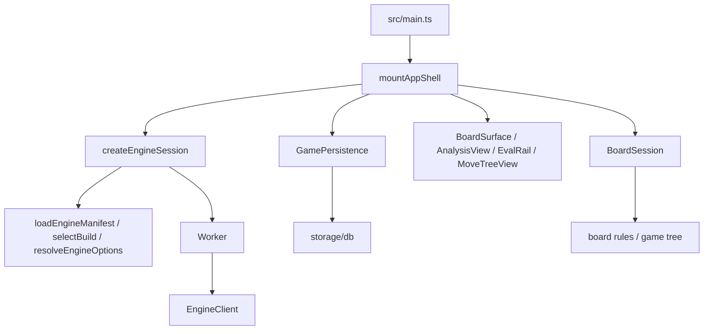
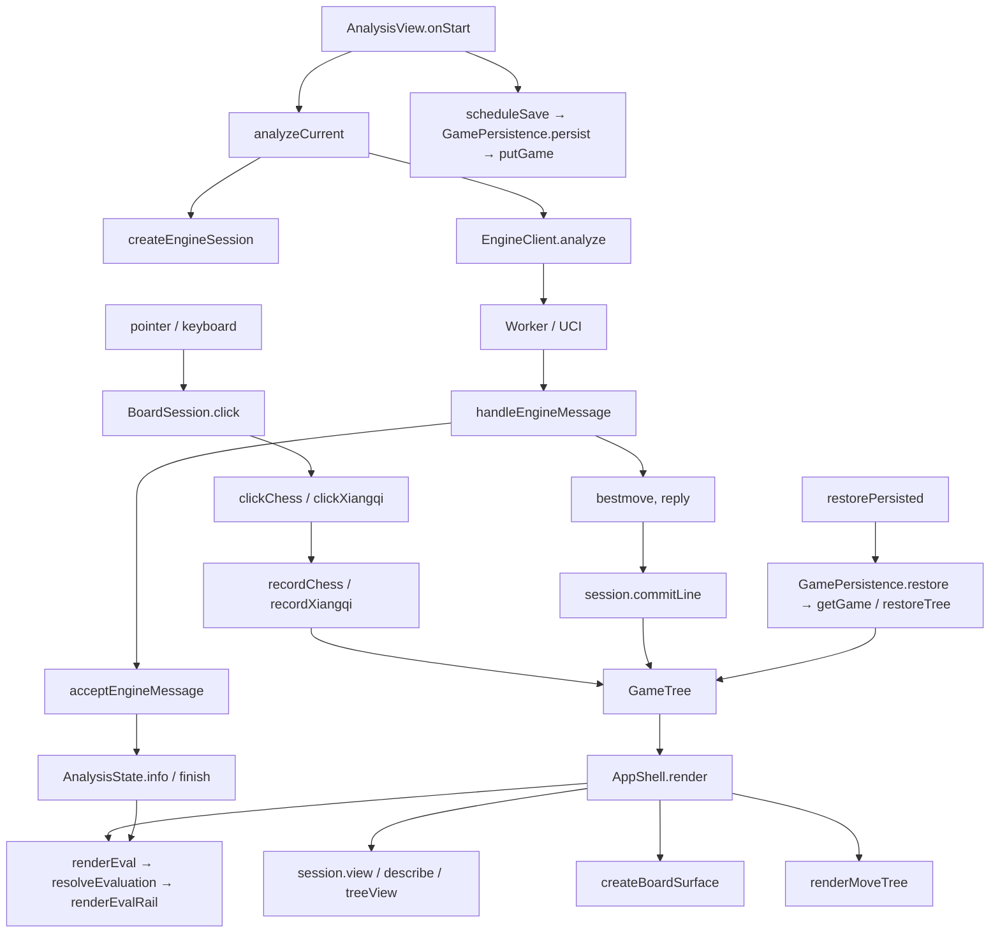

# pCHESS v0.1

本地优先的国际象棋与中国象棋应用。TypeScript + Vite，SVG 棋盘与棋子，
Stockfish/Pikafish 在 Web Worker 中运行，无后端。

## 组件

| 路径                         | 职责                                               |
| ---------------------------- | -------------------------------------------------- |
| `src/app/`                   | 应用控制、走子会话、分析状态、调度器、视图、持久化 |
| `src/board/`                 | 国际象棋/象棋规则、FEN、棋盘交互、棋子绘制、perft  |
| `src/game/`                  | 变着树、PGN 解析与导出                             |
| `src/engine/`                | Worker、EngineClient、UCI、资产校验、Emscripten 桥 |
| `src/storage/`               | IndexedDB 棋局记录                                 |
| `src/editor/`                | 棋盘编辑器                                         |
| `src/i18n.ts`、`src/styles/` | 双语与样式                                         |
| `tools/build-engines.mjs`    | 下载源码/NNUE、打补丁、构建 WASM                   |
| `deploy/nginx.conf`          | COOP/COEP/CSP/MIME 静态服务配置                    |

## 数据流

走子：

```text
输入 → BoardSession → GameTree（分支、光标）
     → 主线程渲染 → IndexedDB（异步、版本 + 光标）
```

分析：

```text
EngineClient.analyze
  → Worker（Emscripten）
  → UCI info/bestmove
  → AnalysisState
  → EvalRail / AnalysisView / 棋盘箭头
```

人机对弈：

```text
人类落子 → EngineReplyScheduler
  → 有限深度搜索（≤12）
  → 校验 bestmove
  → 写入棋谱
  → 只读评估刷新胜率
```

## 函数图谱

### 模块与入口



### 关键路径



## 构建

### 前置

- Node.js 24。
- GNU Make。
- Emscripten 6.0.13，或 `tools/emsdk` 下的本地工具链。

### 一键构建

```bash
npm install --ignore-scripts
npm run build:release
```

该命令在输入缺失时自动下载：

- Stockfish：<https://github.com/official-stockfish/Stockfish>，commit `edb0d9db6731067ec50ce619ff372b463bc4dd5d`
- Pikafish：<https://github.com/official-pikafish/Pikafish>，commit `4c17cee11f888ae1d48a9494f2e2239f019f0a1f`
- Stockfish NNUE：`nn-1a298aa575a0.nnue`
- Pikafish NNUE：从 `Pikafish.2026-09-06.7z` 提取

然后应用 `tools/patches/`，构建四个 WASM：

```text
stockfish/sf_19/{single-simd,threads-simd}
pikafish/Pikafish-2026-09-06/{single-simd,threads-simd}
```

最后写入 `dist/`。源码、NNUE、`dist/`、`release/` 均不进入 Git。

### 分步命令

```bash
node tools/build-engines.mjs --check       # 校验/准备输入，不构建
node tools/build-engines.mjs --fetch-only  # 下载并打补丁，不构建
node tools/build-engines.mjs --refresh     # 丢弃源码缓存后重取
npm run build:engines                      # 只构建引擎
npm run build                              # 只构建应用，要求引擎已存在
npm run dev
npm run preview
```

## 规则与数据

- 国际象棋走子使用 `chess.js 1.4.0`。
- 中国象棋规则、FEN、perft 为仓内实现。
- PGN：国际象棋 RAV 变着；中国象棋 ICCS 坐标。
- 变着树维护根局面、节点、光标；预览线路先整体校验再写入。
- IndexedDB schema 1：国际象棋/中国象棋各一条记录，保存根 FEN、树、版本、光标、标题、时间。
- 分析历史不持久化。
- 设置保存在 LocalStorage；引擎缓存使用 CacheStorage。

## 引擎

| 引擎      | 变体     | 构建                          |
| --------- | -------- | ----------------------------- |
| Stockfish | 国际象棋 | `single-simd`, `threads-simd` |
| Pikafish  | 中国象棋 | `single-simd`, `threads-simd` |

- 四个构建均由 Emscripten 6.0.13 生成。
- 线程版需要 `crossOriginIsolated` 与 COOP/COEP；不满足时回退单线程。
- 分析支持 MultiPV 1–5、深度 8/12/16/20/∞、停止与自动分析。
- 引擎应着有限深度为 `min(分析深度, 12)`；非法 bestmove 不写棋谱。
- NNUE 在加载前校验字节数与 SHA256；缓存命中重新校验 body。

## 许可

- 项目代码：MIT，见 `LICENSE`。
- 仓库不含 Stockfish/Pikafish 二进制。
- 发布制品包含 GPL 引擎二进制与非商业 Pikafish NNUE；对应许可证和 source offer 随包提供。
